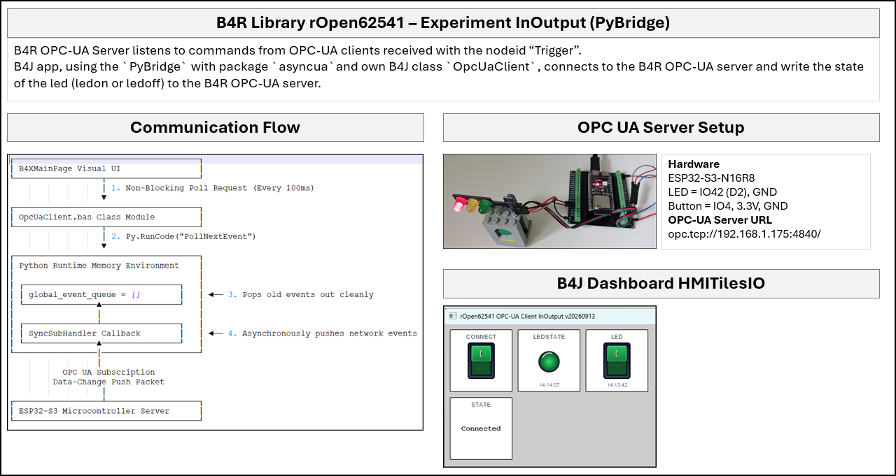

# rOpen62541 InOut Example

## Brief
- This example uses an LED as output and pushbutton as input.
- The state of the LED is set by writing a boolean (true or false) to the node ns=1;s=System.LedState
- Scenario 1
	- The pushbutton sets the state of the LED on or off.
	- If the LED state changes, the nodeid ns=1;System.LedState is updated with false or true.
- Scenario 2
	- The server receives a msg from the connected client with nodeid ns=1;System.LedState.
	- The event OnDataWrite with the nodeid and 4-byte array as value is triggered.
	- Nodeid ns=1;System.LedState is selected and the first byte of the value is used used to set the state of the LED to true or false.

---

## Screenshot

---
