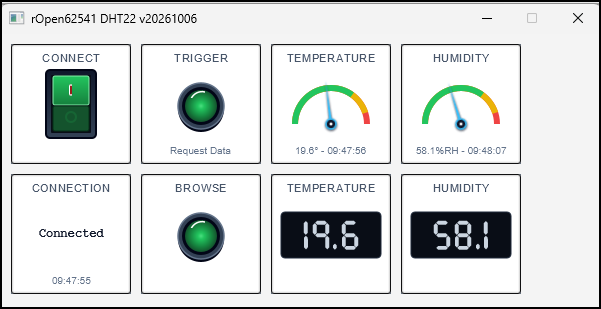
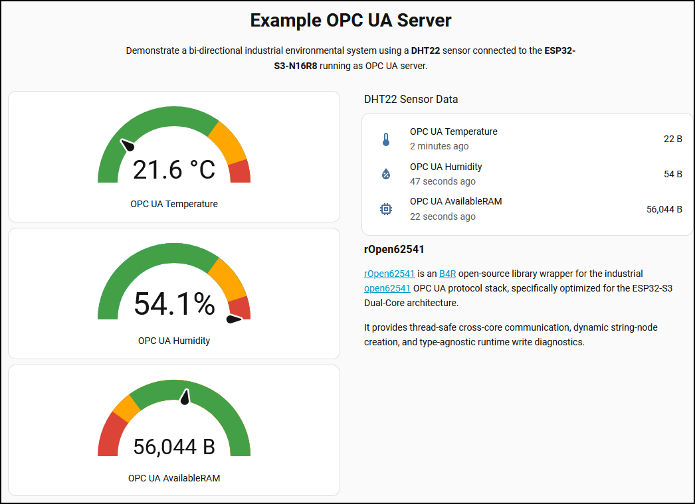
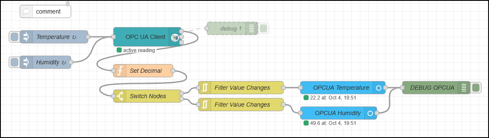
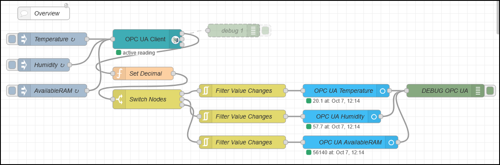
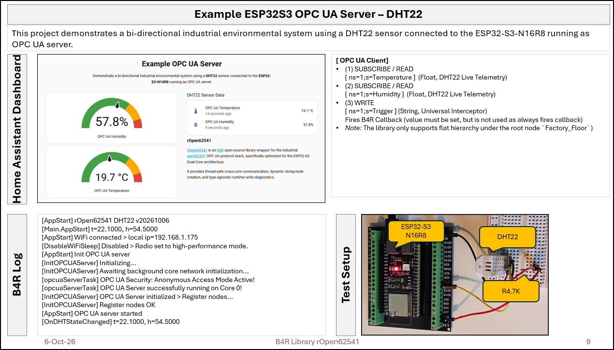
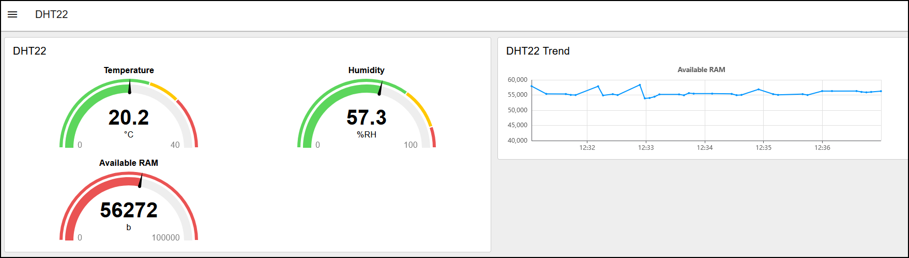
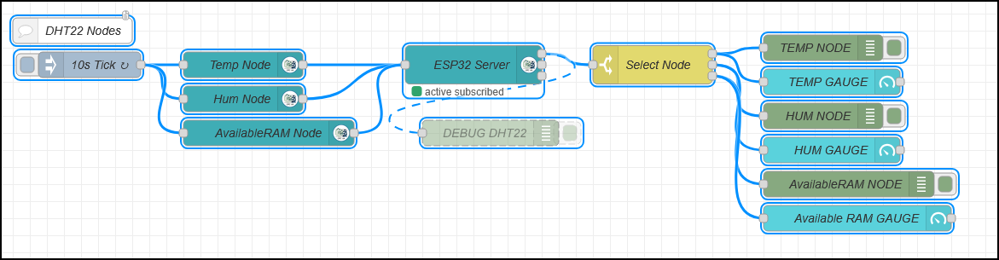
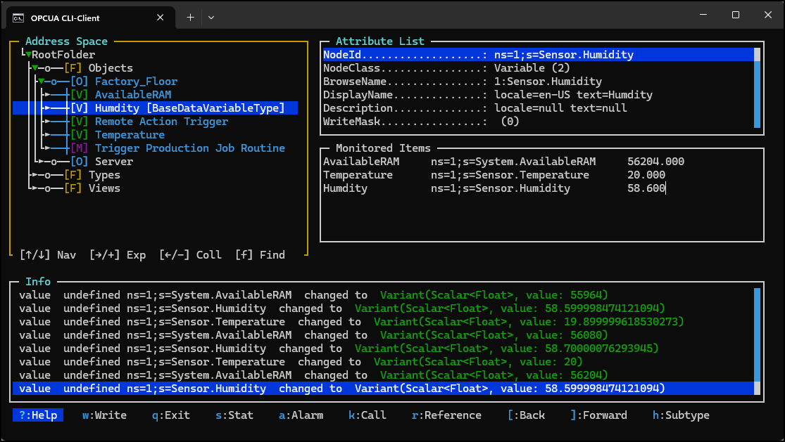

# rOpen62541 DHT22 Example

## Brief
Read and write the DHT22 sensor data Temperature and Humidity as float on every change.
```
DHT22 event [OnDHTStateChanged] t=19.5000, h=57.7000.
```

Created serveral DHT22 examples with different development systems.

OPC UA Nodes:	
- 4 children under ns=1;s=Factory_Floor|BaseObject
- value=ns=1;s=Sensor.Temperature|Temperature|Variable|Float|Write
- value=ns=1;s=Sensor.Humidity|Humdity|Variable|Float|Write					
- value=ns=1;s=System.AvailableRAM|AvailableRAM|Variable|Float|Write					
- value=ns=1;s=Trigger|Remote Action Trigger|Variable|String|Read
- value=ns=1;s=ExecuteJob|Trigger Production Job Routine|Method|String|Read

---

## Screenshots

---

---

---

---

---

---

---

---
