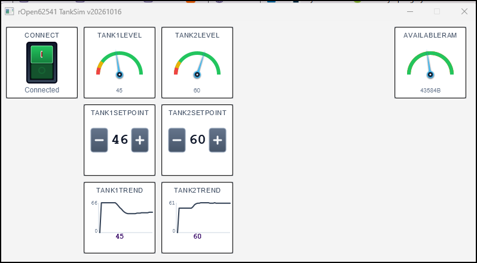

# rOpen62541 OPC UA Tank Simulator Example

B4J with PyBridge `OPC UA client` for the Tank Simulator Example.  
The dashboard monitors real-time telemetry, adjusts loop configurations, tracks memory health variables, and displays historical trending curves natively on the client application layout.

The OPC UA client is created with B4J and the Object-Oriented Class `PyOpcUaClient` for managing OPC UA via PyBridge.
More information in the source code `B4XMainPage.bas`.

---

## Screenshot

---

## OPC UA Node Registries

The simulation exposes **5 core nodes** mapped under Namespace 1 (`ns=1`). All numeric properties are updated synchronously inside the microcontroller execution loop thread.

### Telemetry & Diagnostics Nodes
* **`ns=1;s=Tank1.Level`** 
  * **Data Type:** `Float`
  * **Access:** Read / Write (Source Timestamp Tracking Enabled)
  * **Description:** Monitors the current fluid level of Tank 1 (0.0 to 100.0).
* **`ns=1;s=Tank2.Level`** 
  * **Data Type:** `Float`
  * **Access:** Read / Write (Source Timestamp Tracking Enabled)
  * **Description:** Monitors the current fluid level of Tank 2 (0.0 to 100.0).
* **`ns=1;s=System.AvailableRAM`** 
  * **Data Type:** `Int32`
  * **Access:** Read-Only
  * **Description:** Diagnostics register output tracking free microcontroller hardware heap bytes (e.g., `43584B`).

### Control & Loop Configuration Nodes
* **`ns=1;s=Tank1.Setpoint`** 
  * **Data Type:** `Float`
  * **Access:** Read / Write
  * **Description:** Sets the targeting parameter baseline for the Tank 1 level control loop.
* **`ns=1;s=Tank2.Setpoint`** 
  * **Data Type:** `Float`
  * **Access:** Read / Write
  * **Description:** Sets the targeting parameter baseline for the Tank 2 level control loop.

---

## Nodes
Full list of nodes from which 5 are used for this B4J example:
- Tank1.Level, Tank2.Level, Tank1.Setpoint, Tank1.Setpoint, System.AvailableRAM

### Root Folder 
- **"ns=0;i=85"**
- Nodes found= 2
- NodeId=ns=0;i=2253, DisplayName=Server, NodeClass=Object
- NodeId=ns=1;s=Factory_Floor, DisplayName=Factory_Floor, NodeClass=Object

### Folder Factory_Floor (subfolder from the Root folder)
- **"ns=1;s=Factory_Floor"**
- Nodes found= 23
- NodeId=ns=1;s=Trigger, DisplayName=Remote Action Trigger, NodeClass=Variable
- NodeId=ns=1;s=TriggerResult, DisplayName=Remote Trigger Result, NodeClass=Variable
- NodeId=ns=1;s=System.AvailableRAM, DisplayName=Available RAM, NodeClass=Variable
- NodeId=ns=1;s=Tank1.Level, DisplayName=Tank 1 Level, NodeClass=Variable
- NodeId=ns=1;s=Tank1.InputFlow, DisplayName=Tank 1 Input Flow, NodeClass=Variable
- NodeId=ns=1;s=Tank1.OutputFlow, DisplayName=Tank 1 Output Flow, NodeClass=Variable
- NodeId=ns=1;s=Tank1.Temperature, DisplayName=Tank 1 Temp, NodeClass=Variable
- NodeId=ns=1;s=Tank1.Setpoint, DisplayName=Tank 1 Setpoint, NodeClass=Variable
- NodeId=ns=1;s=Tank1.Kp, DisplayName=Tank 1 Proportional Gain, NodeClass=Variable
- NodeId=ns=1;s=Tank1.Ki, DisplayName=Tank 1 Integral Gain, NodeClass=Variable
- NodeId=ns=1;s=Tank1.Kd, DisplayName=Tank 1 Derivative Gain, NodeClass=Variable
- NodeId=ns=1;s=Tank1.Alarm_HH, DisplayName=Tank 1 High-High Alarm, NodeClass=Variable
- NodeId=ns=1;s=Tank1.Alarm_LL, DisplayName=Tank 1 Low-Low Alarm, NodeClass=Variable
- NodeId=ns=1;s=Tank2.Level, DisplayName=Tank 2 Level, NodeClass=Variable
- NodeId=ns=1;s=Tank2.InputFlow, DisplayName=Tank 2 Input Flow, NodeClass=Variable
- NodeId=ns=1;s=Tank2.OutputFlow, DisplayName=Tank 2 Output Flow, NodeClass=Variable
- NodeId=ns=1;s=Tank2.Temperature, DisplayName=Tank 2 Temp, NodeClass=Variable
- NodeId=ns=1;s=Tank2.Setpoint, DisplayName=Tank 2 Setpoint, NodeClass=Variable
- NodeId=ns=1;s=Tank2.Kp, DisplayName=Tank 2 Proportional Gain, NodeClass=Variable
- NodeId=ns=1;s=Tank2.Ki, DisplayName=Tank 2 Integral Gain, NodeClass=Variable
- NodeId=ns=1;s=Tank2.Kd, DisplayName=Tank 2 Derivative Gain, NodeClass=Variable
- NodeId=ns=1;s=Tank2.Alarm_HH, DisplayName=Tank 2 High-High Alarm, NodeClass=Variable
- NodeId=ns=1;s=Tank2.Alarm_LL, DisplayName=Tank 2 Low-Low Alarm, NodeClass=Variable
