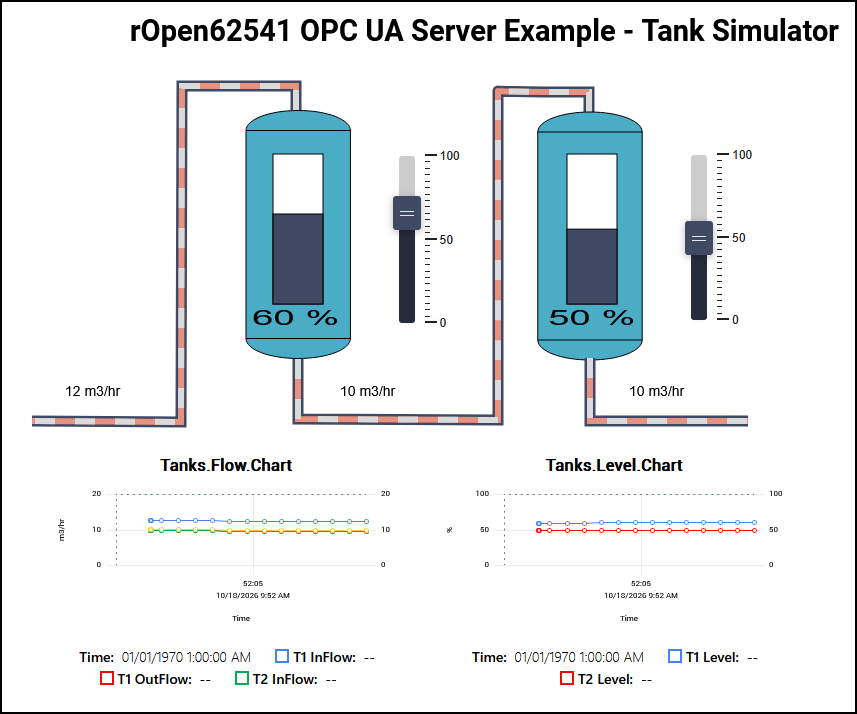

# README.md

`FUXA SCADA Dashboard Integration`

This guide provides the exact configuration parameters and installation procedures for binding the FUXA HMI/SCADA platform to the `rOpen62541` ESP32-S3 Server.

---

## Example
Before starting the guide, lets show a screenshot of the FUXA example `TankSim`:   


---

## Installation & Updates on Windows 11

FUXA runs as a lightweight Node.js application. Follow these instructions to install it from scratch or update an existing installation.

### Prerequisites

1. Download and install Node.js (LTS Version) from the official site: nodejs.org.
2. Open PowerShell or Command Prompt as an Administrator.

### Fresh Installation

To install FUXA globally on a system (Windows, Linux, ...), execute the following command:
```powershell
npm install -g fuxa
```

### Running FUXA

Once installed, start the server backend:
```
cd c:\<installation folder>\FUXA\server
npm start
```
or

```powershell
fuxa
```
followed by:
- Editor URL: Open a browser and navigate to http://localhost:1881 to design the dashboard.
- Runtime View URL: Access the live operator panel at http://localhost:1881/view.

### Updating FUXA to the Latest Version

To update the global FUXA installation to include the newest widget layouts and driver patches, run:
```powershell
npm update -g fuxa
```

### Server Connection Properties

To link FUXA to the ESP32-S3 server over the local network:
1. Open the FUXA Editor (http://localhost:1881).
2. Click Settings (Gear icon in top right corner) > Connections.
3. Click the blue + (Add device) icon and enter these exact parameters:

| Property	      | Value			                | Note                               | 
| =============== | =============================== | ================================== | 
| Name		      | ESP32S3_Server	                | Can be any unique text name        | 
| Type		      | OPCUA			                | Selects the standard OPC UA driver | 
| Address		  | opc.tcp://NNN.NNN.NNN.NNN:4840/ | Matches the ESP32-S3 IP and port   | 
| Security Mode	  | None	                        | No network encryption layer        | 
| Security Policy | None	                        | No security token envelope         | 
| Credentials	  | Leave Blank	                    | Activates Anonymous Access Mode    | 

4. Click Save.
The status indicator dot next to the connection name will turn Green (Connected).

### Tag Management (Adding Nodes)

Before linking variables to graphics, map the explicit server Node IDs:
- Navigate to Settings > Tags.
- Click the blue + icon to register variables:
	- Name: Tank_1_Level (Use underscores or alphanumeric characters only)
	- Device: Select the configured connection (ESP32S3_Server).
	- Address / NodeId: Enter the exact case-sensitive, fully-qualified string identifier matching the B4R constants:
		- Tank 1 Level Tag: ns=1;s=Tank1.Level
		- Tank 1 Setpoint Tag: ns=1;s=Tank1.Setpoint

### Canvas Widget Layout Configuration

#### Animated Tank Level Shapes

Standard vector shapes require an explicit layout instruction to resize dynamically with live numbers:
1. Drag a rectangular Shape layout from the left panel onto the canvas to act as the fluid column.
2. Set its Fill Color to blue.
3. Select the shape, look at the right-hand Properties Panel, and locate the Value field.
4. Click the small tag/link icon and select the level tag (Tank_1_Level).
5. Set Min: 0 and Max: 100 to match the physics scale.
6. CRITICAL STEP: Click the text 1/0 next to the value field and change it to Resizing (or Height / Fill). This instructs the graphic to grow vertically with the streaming variable instead of treating it as an on/off bitmask.
7. Layer a black hollow tank outline vector graphic directly on top of the blue filling shape.

#### Setpoint Control Inputs

To send target parameters from the UI back down to the B4R execution loops:
1. Drag an Input Field control widget from the library onto the canvas.
2. Open its properties on the right and map its Value field directly to the setpoint variable tag (ns=1;s=Tank1.Setpoint).
3. Ensure the text format configuration limits input to Numeric or Float definitions.
4. Switch FUXA to View / Runtime Mode (the Play icon in the top right).
5. Type the target number into the box and press Enter on the keyboard to instantly transmit an external network write over the wire to the ESP32-S3!
