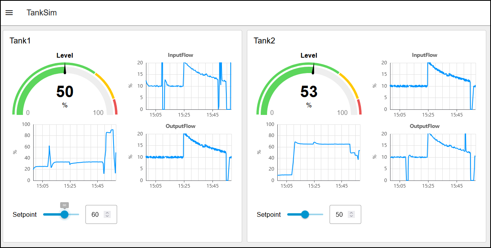
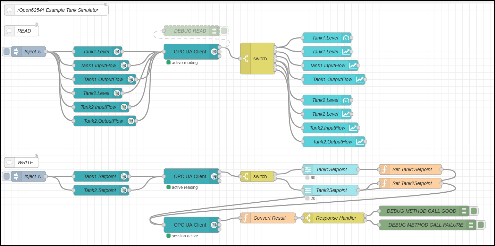

# rOpen62541 OPC UA Tank Simulator Example

[Node-RED](https://nodered.org) example for the Tank Simulator Example.  
The dashboard monitors real-time telemetry, adjusts loop configurations, tracks memory health variables, and displays historical trending curves natively on the client application layout.

The OPC UA client is created with Node-RED and the [Node-RED OPC UA Nodes](https://github.com/mikakaraila/node-red-contrib-opcua).

---

## Screenshots

---

---

